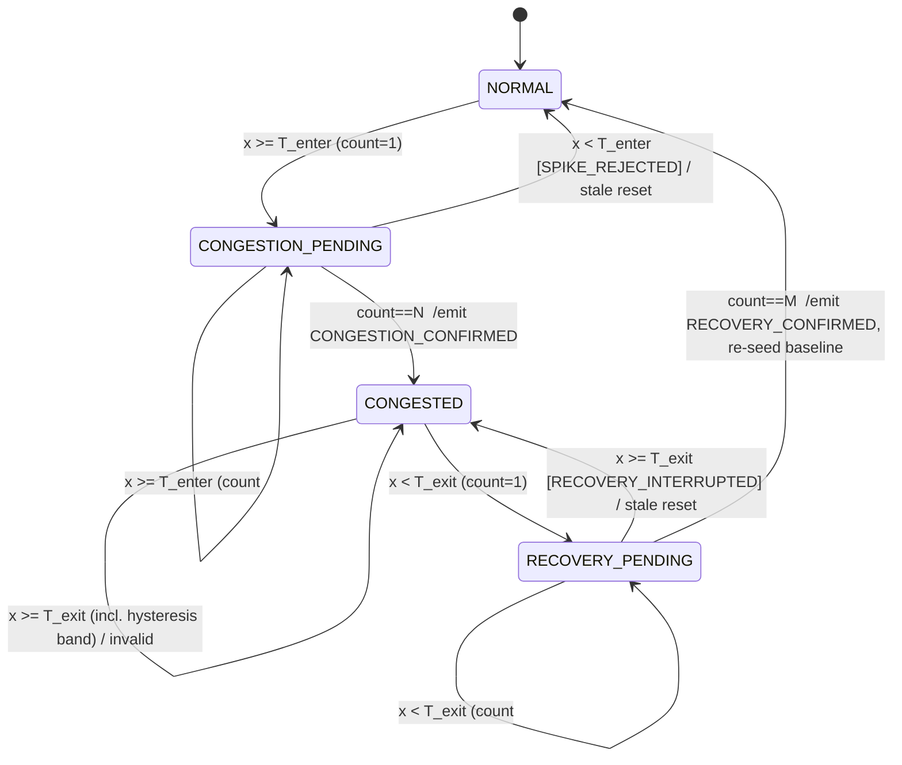

# Adaptive Congestion Detector — Algorithm Specification

Owner: Karna VS (ENG23CS0086). Scope: decide NORMAL / CONGESTED / RECOVERED per monitored port. The detector
reports state only; it never installs flows, selects routes or polls switches.

## 1. Signal
**Link utilization** `x_t = (Δtx_bytes · 8 / Δt) / C`, a unitless fraction (1.0 = 100 %), from OpenFlow port
stats `tx_bytes` (egress side, where queues build) of the monitored port. `C` = configured link capacity in bit/s
(`adapter.capacity_bps["dpid:port"]`). **Capacity is never guessed**: unknown → sample invalid (`UNKNOWN_CAPACITY`).
Higher = more congested. *Limitation:* utilization is a proxy; it does not see queue depth, latency or loss.
A UDP flow at 95 % of capacity and a link that is full with lossy TCP both read "high", and a link can drop
packets below 100 % utilization. Latency/loss are not collected by this module.

Sample validity (adapter): first sample, counter decrease (reset), Δt ≤ 0, Δt > `max_interval_s` (stale),
unknown capacity → invalid, never "normal". Detector additionally rejects negative, NaN/inf, > `max_valid_value`,
non-numeric, out-of-order/duplicate timestamps.

## 2. Adaptive threshold
| Symbol | Meaning |
|---|---|
| `b_t` | EWMA baseline of normal utilization |
| `v_t` | EWMA of absolute deviation `|x − b|`, floored at `min_variation` |
| `T_enter` | `clamp(b + k·v, threshold_min, threshold_max)` |
| `T_exit` | `T_enter − hysteresis_margin` |

1. **Initialisation:** the first `warmup_samples` *non-suspect* valid samples give `b = mean`, `v = mean|x−b|`.
   Until then `T_enter = threshold_max` (fixed ceiling), so a link that is congested at startup is still detected.
2. **Adaptation:** `v ← α|x−b| + (1−α)v ; b ← αx + (1−α)b`, **only** when state is `NORMAL` and `x < T_enter`.
3. **Congested samples never train the baseline** (pending, congested and recovery-pending samples are excluded and the
   baseline is frozen), so sustained congestion cannot drag the threshold up until it stops detecting.
4. **Re-seed on recovery:** at `RECOVERY_CONFIRMED`, `b ←` mean of the recovery samples (handles a permanently changed
   normal regime; otherwise a stale low baseline could re-trigger immediately). If warm-up never finished, the
   recovery samples count as warm-up data.
5. **Bounds:** `threshold_min` stops tiny variance on idle links producing a hair-trigger; `threshold_max` guarantees
   saturation is always detectable even if the baseline drifts high.
6. **Invalid samples** never update `b`/`v`.
7. **Known weakness:** a *slow* ramp is tracked by the EWMA and is only caught when it reaches `threshold_max`
   (see `gradual_increase` in the test report). That is the price of adaptivity; `threshold_max` is the backstop.

## 3. Persistence, hysteresis, recovery
* **Persistence is sample-count based** (consecutive valid samples), not elapsed-time based, because the controller
  polls at a fixed period. Consequence: wall-clock latency = `(N−1)·poll_interval`; irregular polls change latency
  but not the count. Polls with Δt > `max_interval_s` are invalid instead of being averaged.
* **Entry:** `enter_persistence` consecutive valid samples with `x ≥ T_enter`. One lower sample cancels (`SPIKE_REJECTED`).
* **Exit:** `exit_persistence` consecutive valid samples with `x < T_exit`. Any sample `≥ T_exit` — including one in the
  band `[T_exit, T_enter)` — resets the recovery count (`RECOVERY_INTERRUPTED`).
* **Hysteresis band `[T_exit, T_enter)`:** from `CONGESTED` the state is held (`IN_HYSTERESIS_BAND`); from `NORMAL` the
  sample is simply "below entry".
* **Invalid samples are neutral evidence:** they never count toward congestion or recovery and do not reset counters,
  until `max_invalid_streak` consecutive invalid samples; then `CONGESTION_PENDING→NORMAL` and
  `RECOVERY_PENDING→CONGESTED` (fail-safe fallback to the last *confirmed* state). `NORMAL` and `CONGESTED` never change on
  invalid data, so an outage can't fabricate recovery. Trade-off: a dropout inside a pending run delays, not cancels, it.

## 4. State machine

| From | Condition (valid sample) | To | Event emitted |
|---|---|---|---|
| NORMAL | `x < T_enter` | NORMAL (baseline learns) | – |
| NORMAL | `x ≥ T_enter` | CONGESTION_PENDING (CONGESTED if N=1) | CONGESTION_CONFIRMED only if N=1 |
| CONGESTION_PENDING | `x ≥ T_enter`, count<N | same | – |
| CONGESTION_PENDING | `x ≥ T_enter`, count=N | CONGESTED | **CONGESTION_CONFIRMED** |
| CONGESTION_PENDING | `x < T_enter` | NORMAL | – |
| CONGESTED | `x ≥ T_exit` | CONGESTED | – (no repeat events) |
| CONGESTED | `x < T_exit` | RECOVERY_PENDING (NORMAL if M=1) | RECOVERY_CONFIRMED only if M=1 |
| RECOVERY_PENDING | `x < T_exit`, count<M | same | – |
| RECOVERY_PENDING | `x < T_exit`, count=M | NORMAL | **RECOVERY_CONFIRMED** |
| RECOVERY_PENDING | `x ≥ T_exit` | CONGESTED | – |
| any | invalid sample | unchanged (streak ≥ limit: pending → last confirmed) | – |

*State* (`Decision.state`) is persistent; *events* (`Decision.event`) are one-shot and fire only on the two bold rows.
Intermediate transitions are visible via `state_changed` and the JSONL log but are not sent to the router.

## 5. Pseudocode
```
update(sample):
  t_enter,t_exit = thresholds()              # warm-up: t_enter = threshold_max
  if invalid(sample): streak++; if streak>=L: PENDING states fall back; return neutral decision
  streak = 0
  switch state:
    NORMAL:   if x>=t_enter: count=1; state=PENDING (or CONGESTED+EVENT if N==1)  else learn(x)
    PENDING:  if x>=t_enter: count++; if count>=N: state=CONGESTED; EVENT(congestion)  else state=NORMAL
    CONGESTED:if x<t_exit: rcount=1; buf=[x]; state=RECOVERY_PENDING (or recover() if M==1)
    RECOVERY: if x<t_exit: rcount++; buf+=x; if rcount>=M: recover() ; EVENT(recovery)
              else state=CONGESTED; rcount=0
recover(): baseline = mean(buf); state=NORMAL
```

## 6. Parameters (defaults are INITIAL and UNTUNED — see TEST_REPORT §Limitations)
| Name | Default | Unit / range | Rationale |
|---|---|---|---|
| `alpha` | 0.1 | (0,1] | ≈10-sample memory at 1 s polling; slow enough to ignore short bursts |
| `k` | 3.0 | ≥0, utilization | 3 mean-abs-deviations ≈ conservative boundary |
| `min_variation` | 0.02 | >0, utilization | stops zero-variance idle links giving `T_enter ≈ baseline` |
| `warmup_samples` | 10 | ≥1 samples | 10 s at 1 s polling |
| `threshold_min` | 0.40 | utilization | below 40 % load is not treated as congestion |
| `threshold_max` | 0.85 | utilization ≤ `max_valid_value` | saturation always detectable |
| `hysteresis_margin` | 0.10 | 0 < m < `threshold_min` | keeps `T_exit` positive |
| `enter_persistence` | 3 | samples | rejects ≤2-sample bursts; delay (N−1)·Δt |
| `exit_persistence` | 5 | samples | slower to recover than to enter (anti-flap) |
| `max_invalid_streak` | 5 | samples | pending state abandoned after ~5 s without data |
| `max_valid_value` | 2.0 | utilization | rejects implausible rates |
| adapter `max_interval_s` | 30 | s | set to ≈ 3–5× poll interval for your controller |
These were chosen from reasoning about a 1 s poll / 10 Mbit/s testbed, **not** tuned on Mininet results.

## 7. Failure policy
Missing reply → no sample (Δt grows; if > `max_interval_s` the next sample is `STALE_INTERVAL`). Counter reset / switch
reconnect → invalid, counters re-baselined (`forget_switch` on disconnect drops them). First observation → invalid
(`FIRST_SAMPLE`). Controller restart → fresh detectors, new warm-up. Duplicate/out-of-order → `OUT_OF_ORDER_OR_DUPLICATE`.
Counter *decrease* is always treated as reset (64-bit wrap-around not modelled).
